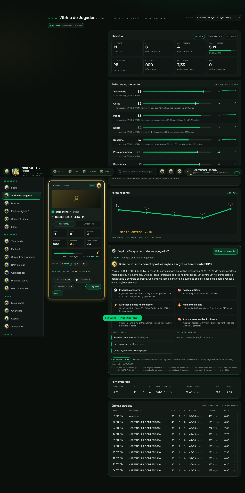

# Vitrine do Jogador

Aba dedicada a mostrar um atleta para quem pode contratá-lo: clubes, scouts, agentes e o próprio atleta.
Rota da SPA: `#/vitrine?athleteId={id}` (sem `athleteId`: o próprio atleta, ou o primeiro do ranking).
Entradas: menu lateral **Descobrir → Vitrine do Jogador**, ação **Vitrine →** nos cards de atleta e o nome do jogador no ranking.



## O que o painel mostra

| Bloco | Conteúdo | Fonte |
|---|---|---|
| Card do atleta | `.vcard` com as regras de privacidade de sempre (condicionamento só para quem pode ver saúde) | `CardAssembler` |
| Histórico | Partidas (oficiais), gols, assistências, passes certos, dribles certos, minutos, nota média, MVP; desarmes para defensores e jogos sem sofrer gol para goleiros. Alterna **Carreira · Temporada · Últimas 5** | `match_performances` |
| Atributos no momento | Velocidade, Chute, Passe, Drible, Desarme, Posicionamento, Resistência (0–100), variação, tendência de 12 semanas e o motivo de cada número | `scouting_attributes` + súmulas |
| Forma recente | Notas das últimas 5 partidas contra a média das anteriores: **Em alta** (≥ +0,30), **Estável** ou **Em queda** (≤ −0,30) | `match_performances` |
| Por temporada · Últimas partidas | Tabelas com passes e dribles certos/tentados, nota, MVP e a origem (✓ súmula oficial · ✎ autorrelato) | `match_performances` |
| Copilot | Resposta a **"Por que contratar este jogador?"** | regras abaixo |

### Dinâmico

`GET /v1/athletes/{id}/vitrine` devolve `revision` e `refreshSeconds` (30). A SPA consulta nesse intervalo enquanto a aba está
aberta e visível, e só redesenha quando `revision` muda: os números novos piscam com ▲/▼. Se o Copilot já respondeu, a resposta
é refeita com os dados novos. Ao sair da aba, a consulta para.

### Atributos "conforme o momento atual"

```
valor = scouting da semana mais recente + ajuste de forma (limitado a ±5)
```

O ajuste compara as últimas 5 partidas com as anteriores e só existe onde a súmula mede o atributo:

| Atributo | Ajuste |
|---|---|
| Passe | Δ de passes certos (p.p.) ÷ 2 |
| Drible | Δ de dribles certos (p.p.) ÷ 2 |
| Chute | Δ de gols por 90 min × 10 |
| Desarme | Δ de desarmes por 90 min × 2 |
| Velocidade, Posicionamento, Resistência | sem ajuste: vale o scouting da semana |

Sem 3 partidas recentes e 3 anteriores, vale só o scouting. Cada atributo traz `reason` com a conta (ex.: `+1 no scouting (W43 → W44) · forma +2: dribles certos 56,5% nas últimas 5 vs 52% antes`).
Aproveitamentos sem tentativa registrada saem `null`, nunca 0 %.

## Copilot · "Por que contratar este jogador?"

`POST /v1/athletes/{id}/vitrine/copilot` devolve `headline`, `answer`, até 6 `reasons` (cada uma com a evidência numérica),
`bestFit`, `attention`, `confidence` (ALTA · MÉDIA · BAIXA), `sources` e o brasão do tier.

- **Determinístico**, como o Copilot do criador de cards: regras sobre os dados abertos do Gêmeo, sem LLM externo.
- **Sem dados de saúde** (LGPD Art. 11): o serviço não lê treinos, prontidão, ACWR nem lesões.
- **Consentimento do titular**: exige que o **atleta** tenha ligado "Processamento por agentes de IA" (Art. 7º, I · Art. 20).
  O próprio atleta recebe `AI_PROCESSING_OPT_IN` (com atalho para a Central de Privacidade); terceiros recebem `ATHLETE_AI_OPT_OUT`.
- **Menores de 18** não são analisados: `COPILOT_MINOR` (Art. 14 · ECA Digital).
- **Pontos de atenção honestos**: amostra pequena, maioria de autorrelato, forma ou atributo em queda, disciplina, passe abaixo de 70 %, súmulas sem passes/dribles.
- Rotulado como gerado por IA; a decisão de contratar é humana (Art. 20).

## Acesso

Mesma regra do perfil e do Gêmeo (`AccessPolicy.requireProfile`): o dono; perfis `PUBLICO` de conta ativa (menor só com consentimento do responsável);
`CONEXOES` para conexões mútuas. Fora disso, **404**.

## Súmula: passes e dribles

`POST /v1/matches/performances` aceita `passesCompleted`, `passesAttempted`, `dribblesCompleted` e `dribblesAttempted` (opcionais).
Certos acima de tentados respondem `400 MATCH_INVALID`; só "certos" informado conta como tentados = certos. Migração: `V7__match_passes_dribles.sql`.
